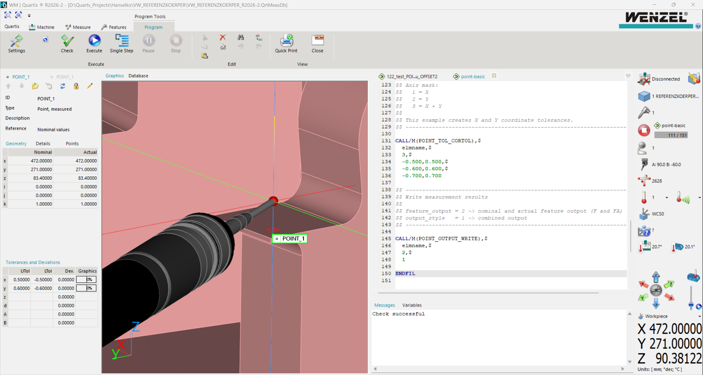
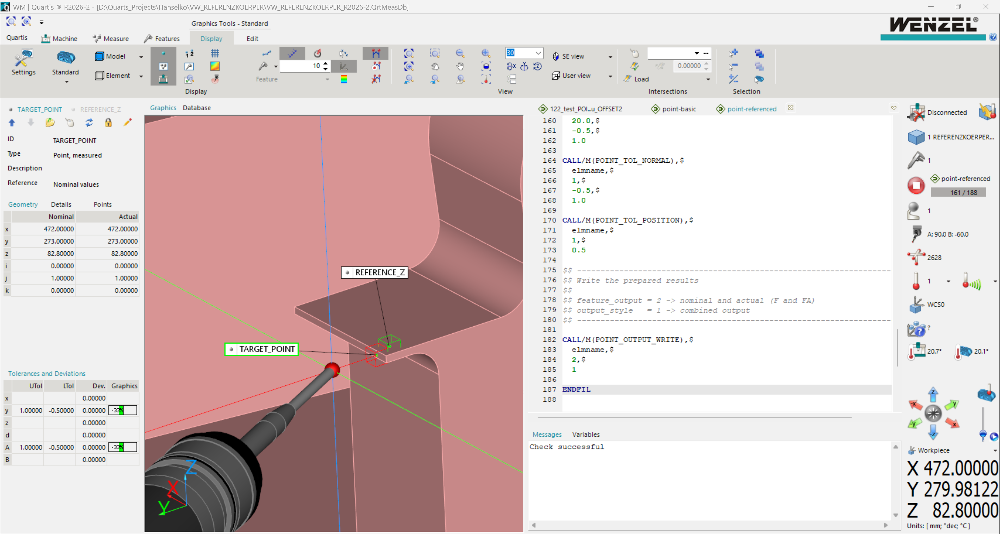
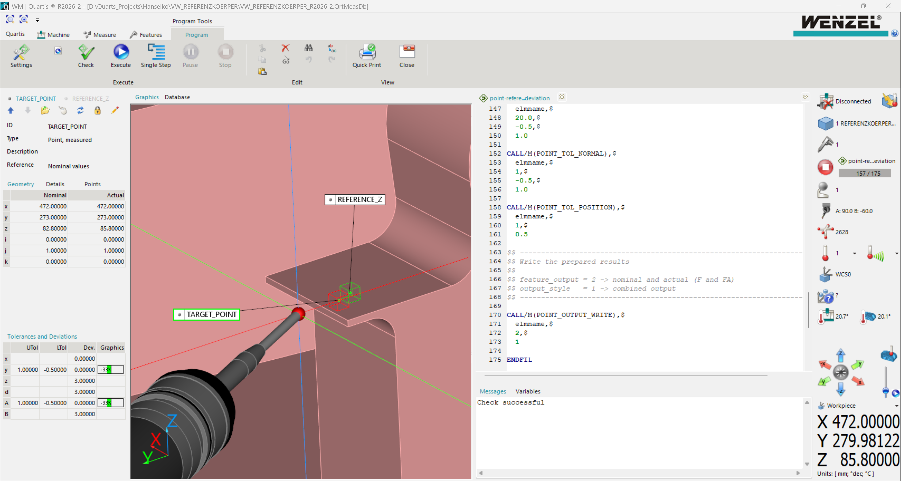
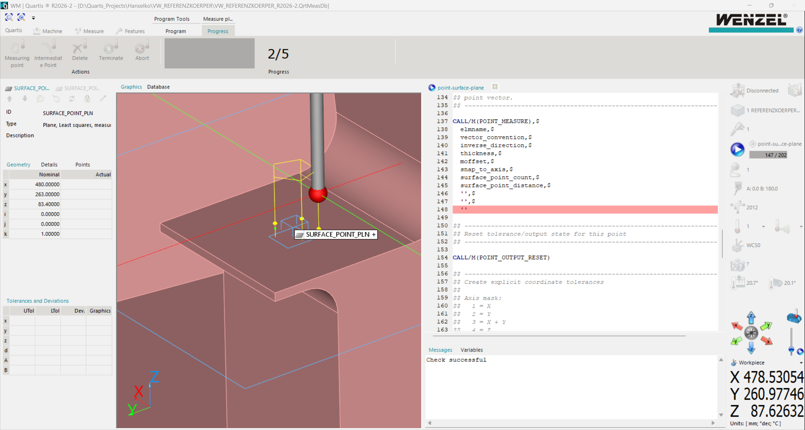
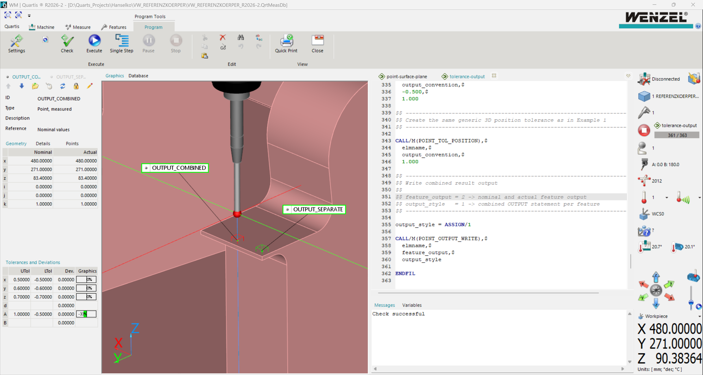

# DMIS Macro Library

A reusable **DMIS 5.2 macro library** for measurement strategies, tolerance generation, feature construction, and result output, developed for use with **WM | Quartis**.

The project provides reusable DMIS measurement functionality while keeping nominal feature definitions, probe selection, machine movements, and part-specific parameters in the calling DMIS program.

The current stable development focus is on point measurement and point evaluation. Additional feature types and specialized strategies are planned over time.

> **Project status:** Experimental / early development
> The public API and individual measurement strategies may still change before version 1.0.0.

## Features

The library currently provides reusable macros for:

- point measurement
- dominant-axis and output-axis determination
- material-thickness correction
- inverse measurement direction
- additional measurement offsets
- reference-feature compensation
- coordinate-axis snapping
- surrounding-plane measurement
- actual surface-vector evaluation
- coordinate tolerance generation
- vector-based tolerance calculation
- normal/profile tolerances
- 3D position tolerances
- separate and combined result output
- experimental specialized feature strategies

## Architecture

The current point-processing API separates processing into three layers:

1. **Measurement** - determines how a physical point is probed and how the actual feature is constructed.
2. **Tolerance generation** - determines which tolerances are created and how tolerance limits and names are generated.
3. **Output** - determines how previously prepared tolerance results are written to the result output.

This separation allows measurement strategies, tolerance conventions, and output formatting to evolve independently.

A typical workflow is:

```text
Nominal feature
      |
      v
POINT_MEASURE
      |
      v
POINT_OUTPUT_RESET
      |
      +---------------------+
      |                     |
      v                     v
POINT_TOL_*          POINT_TOL_NORMAL /
                     POINT_TOL_POSITION
      |                     |
      +----------+----------+
                 |
                 v
        POINT_OUTPUT_WRITE
                 |
        +--------+--------+
        |                 |
        v                 v
   Separate output   Combined output
```

For a detailed description of the internal design, see [docs/architecture.md](docs/architecture.md).

## Main macros

### Measurement and utilities

- `POINT_GET_MAIN_AXES`
- `POINT_MEASURE`

### Tolerance generation

- `POINT_TOL_CORTOL`
- `POINT_TOL_MAIN_AXES`
- `POINT_TOL_VECTOR_CORTOL`
- `POINT_TOL_NORMAL`
- `POINT_TOL_POSITION`

### Output

- `POINT_OUTPUT_RESET`
- `POINT_OUTPUT_WRITE`
- `POINT_OUTPUT_COMBINED_F`
- `POINT_OUTPUT_COMBINED_FA`

## Basic usage

Conceptually, point processing follows this sequence:

```dmis
$$ Define nominal feature
F(POINT_1)=FEAT/POINT,CART,...

$$ Measure point
CALL/M(POINT_MEASURE),...

$$ Reset output state
CALL/M(POINT_OUTPUT_RESET)

$$ Generate required tolerances
CALL/M(POINT_TOL_MAIN_AXES),...
CALL/M(POINT_TOL_NORMAL),...

$$ Write results
CALL/M(POINT_OUTPUT_WRITE),...
```

The exact parameters depend on the selected measurement and output strategy.

## Library file

The main library is located at:

```text
src/QuartisSystemMacros.dmi
```

The library declares:

```dmis
DMISMD/'QuartisSystemMacros',05.2
```

The library contains the reusable macro implementations. Machine- and part-specific commands remain in the calling DMIS program.

## Documentation

Detailed technical documentation is available under `docs/`:

| Document | Description |
|---|---|
| [architecture.md](docs/architecture.md) | Overall library architecture, processing layers and global state |
| [point-measurement.md](docs/point-measurement.md) | `POINT_MEASURE`, reference compensation, axis snapping and surrounding-plane measurement |
| [point-tolerances.md](docs/point-tolerances.md) | Coordinate, vector-based, normal/profile and position tolerances |
| [point-output.md](docs/point-output.md) | Output state, separate output and combined output |
| [customer-conventions.md](docs/customer-conventions.md) | Generic and customer-specific naming and measurement conventions |

## Examples

The `examples/` directory contains neutral example programs demonstrating the library API.

| Example | Demonstrates |
|---|---|
| `examples/point-basic.dmi` | Basic single-point measurement and explicit coordinate tolerances |
| `examples/point-referenced.dmi` | Point measurement using the measured deviation of a reference feature |
| `examples/point-referenced-with-deviation.dmi` | Reference compensation using a deliberately simulated `+3.0 mm` Z deviation |
| `examples/point-surface-plane.dmi` | Surrounding-plane measurement and construction of the final point from the measured surface |
| `examples/tolerance-output.dmi` | Coordinate, normal/profile and position tolerances with separate and combined output |
| `examples/hexagon-experimental.dmi` | Experimental measurement and explicit tolerance/output handling for a hexagonal internal feature |

The examples are intended to demonstrate individual library features without containing proprietary part or customer data.

> Probe selection, machine movements, nominal coordinates, sensor configuration, and clearance positions in the examples must be checked and adapted to the target measurement system before execution.

## Tested examples

The example programs have been exercised in **WM | Quartis** during development.

The screenshots document the tested workflows and are stored in the `screenshots/` directory.

### Basic point measurement

The basic example demonstrates:

```text
nominal point
    -> POINT_MEASURE
    -> POINT_OUTPUT_RESET
    -> POINT_TOL_CORTOL
    -> POINT_OUTPUT_WRITE
```



### Referenced point measurement

The referenced example demonstrates measurement of a target point using the measured coordinate deviation of another feature as a reference.

The reference feature can independently affect the X, Y, or Z technical probing position.



### Referenced measurement with simulated deviation

This example intentionally simulates a reference-feature Z deviation:

```text
Reference nominal Z = 83.4 mm
Reference actual Z  = 86.4 mm
Reference deviation = +3.0 mm
```

The target point uses `REFERENCE_Z` as its Z reference.

The resulting target position demonstrates that the reference deviation shifts the technical probing position and remains part of the measured result.



### Surrounding-plane measurement

Instead of measuring a single probing point, the surrounding-plane strategy distributes multiple probing points around the technical measurement position.

The library then:

1. measures the surrounding plane
2. evaluates the actual plane position and normal vector
3. applies the required technical corrections
4. constructs the final actual point from the measured plane and a theoretical result line



### Tolerance and output strategies

The tolerance-output example processes two point features using the same tolerance configuration.

The example prepares:

- X coordinate tolerance
- Y coordinate tolerance
- Z coordinate tolerance
- normal/profile tolerance
- 3D position tolerance

The first point uses:

```text
output_style = 0
```

to create separate `OUTPUT` statements.

The second point uses:

```text
output_style = 1
```

to create combined output.

This allows both output concepts to be compared using otherwise equivalent tolerance definitions.



## DMO test artifacts

The `dmo/` directory contains DMO result files generated while executing the example programs during development and testing.

These files complement the screenshots by providing the generated DMIS result output for review.

| Example | Generated DMO |
|---|---|
| `point-basic.dmi` | `dmo/point-basic__M1.dmo` |
| `point-referenced.dmi` | `dmo/point-referenced__M1.dmo` |
| `point-referenced-with-deviation.dmi` | `dmo/point-referenced-with-deviation__M1.dmo` |
| `point-surface-plane.dmi` | `dmo/point-surface-plane__M1.dmo` |
| `tolerance-output.dmi` | `dmo/tolerance-output__M1.dmo` |
| `hexagon-experimental.dmi` | `dmo/hexagon-experimental__M1.dmo` |

The DMO artifacts can be used to review generated output such as:

- nominal feature output
- actual feature output
- generated tolerance names
- coordinate tolerances
- normal/profile tolerances
- position tolerances
- diameter tolerances
- separate output
- combined output

The files document individual test runs only. They are not certified reference results for other machines, workpieces, probe configurations, software versions, or measurement environments. A changed library version may intentionally produce different output.

Additional information is available in [dmo/README.md](dmo/README.md).

## Reference compensation

`POINT_MEASURE` supports optional reference features for X, Y, and Z.

For each enabled reference axis:

```text
reference deviation =
    actual reference coordinate
    - nominal reference coordinate
```

The technical probing position is calculated conceptually as:

```text
technical probing position =
    nominal point position
    + reference-feature coordinate deviation
    + material-side correction
    + measurement offset
```

Reference deviations are used to locate the expected physical workpiece position.

They are intentionally not removed automatically from the final measured result.

See [docs/point-measurement.md](docs/point-measurement.md).

## Surrounding-plane strategy

When:

```text
surface_point_count >= 3
```

`POINT_MEASURE` switches from direct single-point measurement to surrounding-plane measurement.

The strategy:

1. calculates the technical measurement position
2. builds two orthogonal unit vectors in the nominal surface
3. distributes probing points around the technical point
4. measures an actual plane
5. evaluates the actual surface
6. removes technical material/measurement-offset displacement where required
7. constructs the final point from the measured plane and a theoretical line

With:

```text
snap_to_axis = 0
```

the result line follows the nominal point vector.

With:

```text
snap_to_axis = 1
```

the result line follows the dominant coordinate axis.

## Coordinate-axis selection

Coordinate tolerances use a bit-mask representation:

```text
0 = no coordinate tolerance
1 = X
2 = Y
3 = X + Y
4 = Z
5 = X + Z
6 = Y + Z
7 = X + Y + Z
```

The dominant axis uses the same bit values:

```text
1 = X
2 = Y
4 = Z
```

`POINT_GET_MAIN_AXES` determines the dominant coordinate axis from the normalized nominal point vector.

An optional angular limit allows secondary axes to be included.

## Tolerance strategies

The library provides three coordinate-tolerance strategies.

### Explicit coordinate tolerances

`POINT_TOL_CORTOL`

The caller provides the axis mask and the lower/upper tolerance limits directly.

### Main-axis coordinate tolerances

`POINT_TOL_MAIN_AXES`

Coordinate tolerances are calculated from:

- the nominal point vector
- a normal tolerance
- the dominant axis
- an optional angular limit

### Vector-based coordinate tolerances

`POINT_TOL_VECTOR_CORTOL`

Every relevant non-zero nominal-vector component receives a calculated coordinate tolerance.

Very small components are ignored using an internal epsilon.

Additional tolerance macros provide:

- `POINT_TOL_NORMAL`
- `POINT_TOL_POSITION`

See [docs/point-tolerances.md](docs/point-tolerances.md).

## Output strategies

Tolerance definition and output are deliberately separated.

Before preparing tolerances for a new point:

```dmis
CALL/M(POINT_OUTPUT_RESET)
```

After creating all required tolerances:

```dmis
CALL/M(POINT_OUTPUT_WRITE),$
  point_name,$
  feature_output,$
  output_style
```

### Feature output

```text
0 = nominal feature only
1 = actual feature only
2 = nominal and actual feature
```

### Output style

```text
0 = separate OUTPUT statements
1 = combined OUTPUT statement per feature
```

See [docs/point-output.md](docs/point-output.md).

## Customer conventions

The library currently provides configurable behavior for:

```text
0 = Generic
1 = Volkswagen / Audi
2 = Mercedes-Benz
3 = BMW
```

These conventions can influence:

- nominal-vector interpretation
- material-thickness handling
- normal/profile tolerance naming
- normal/profile tolerance type
- 3D position tolerance naming

These names describe implementation behavior only.

This project is not an official library of, and is not affiliated with, any referenced vehicle manufacturer.

See [docs/customer-conventions.md](docs/customer-conventions.md).

## Experimental strategies

Experimental or specialized strategies are kept separate from the stable point-macro API.

See:

```text
experimental/
```

The current experimental area includes the `HEX_*` strategy for internal hexagonal features.

Experimental code should be validated carefully before use and may change independently of the stable core macros.

## Requirements

- A DMIS environment compatible with the statements used by this library
- WM | Quartis for the currently targeted implementation
- appropriate machine and probe configuration supplied by the calling program
- validated nominal features and coordinate systems
- safe, validated machine movements and clearance positions

The availability and behavior of individual statements may depend on the installed measurement-software version and machine configuration.

## Safety and validation

> **WARNING:** These macros can influence coordinate measuring machine movements, probe paths, measurement positions, feature construction, tolerances, and reported results.

All macros and measurement strategies must be reviewed, simulated, and validated by qualified personnel before use on physical measurement equipment.

In particular, users must verify:

- probe selection and probe orientation
- approach and retract behavior
- clearance positions and travel paths
- machine movements and coordinate systems
- collision risks
- material-thickness and measurement-offset conventions
- reference-feature behavior
- generated feature geometry
- generated tolerances
- reported measurement results

New or modified macros should first be tested in simulation and, where applicable, on the physical machine using appropriate collision-prevention measures and reduced machine speed.

The software and macros are provided **"AS IS"**, without warranty of any kind.

To the extent permitted by applicable law, the authors and contributors accept no liability for damage resulting from the use of this project, including but not limited to machine collisions, damaged probes or measurement equipment, damaged workpieces, production losses, incorrect measurements, incorrect tolerances, or incorrect measurement results.

Use of this project is entirely at the user's own risk.

A syntactically valid DMIS program does not guarantee a safe machine movement or a technically correct measurement strategy.

## Project structure

```text
dmis-macro-library/
|
|-- README.md
|-- LICENSE
|-- CHANGELOG.md
|
|-- src/
|   `-- QuartisSystemMacros.dmi
|
|-- docs/
|   |-- architecture.md
|   |-- point-measurement.md
|   |-- point-tolerances.md
|   |-- point-output.md
|   `-- customer-conventions.md
|
|-- examples/
|   |-- point-basic.dmi
|   |-- point-referenced.dmi
|   |-- point-referenced-with-deviation.dmi
|   |-- point-surface-plane.dmi
|   |-- tolerance-output.dmi
|   `-- hexagon-experimental.dmi
|
|-- tests/
|   `-- README.md
|
|-- dmo/
|   |-- README.md
|   |-- point-basic__M1.dmo
|   |-- point-referenced__M1.dmo
|   |-- point-referenced-with-deviation__M1.dmo
|   |-- point-surface-plane__M1.dmo
|   |-- tolerance-output__M1.dmo
|   `-- hexagon-experimental__M1.dmo
|
`-- screenshots/
    |-- point-basic.png
    |-- point-referenced.png
    |-- point-referenced-with-deviation.png
    |-- point-surface-plane.png
    |-- tolerance-output.png
    `-- hexagon-experimental.png
```

## Versioning

The project uses semantic versioning.

The initial public development version is planned as:

```text
0.1.0
```

Versions before `1.0.0` should be considered development releases.

Interfaces and behavior may change while measurement strategies, parameter conventions, tolerance handling, and output behavior are further validated and refined.

See [CHANGELOG.md](CHANGELOG.md).

## Testing

The repository uses three complementary forms of test documentation:

1. **Example programs** under `examples/` define reproducible integration scenarios.
2. **Screenshots** under `screenshots/` document execution and geometric behavior observed during development testing.
3. **DMO artifacts** under `dmo/` preserve the generated result output for review.

The detailed test matrix is maintained in [tests/README.md](tests/README.md).

The matrix includes:

- dominant-axis selection
- secondary-axis selection
- direct point measurement
- reference compensation
- surrounding-plane measurement
- coordinate tolerance masks
- vector-derived tolerances
- customer-specific tolerance conventions
- output-state handling
- separate output
- combined output

A test result marked `PASS` documents successful execution of the defined test scenario in the recorded test environment.

It does **not** certify the library for unrestricted production use or guarantee equivalent behavior on another machine, probe system, workpiece, fixture, or software version.

Testing on one configuration does not guarantee safe or correct operation on another machine, probe system, fixture, workpiece, or software version.

## Contributing

Suggestions, test cases, corrections, and additional reusable DMIS strategies are welcome.

Contributions should:

- avoid proprietary measurement programs and customer data
- use neutral example identifiers where practical
- document assumptions and expected behavior
- include a reproducible test case where practical
- clearly identify Quartis-specific behavior
- distinguish standardized DMIS behavior from implementation-specific behavior
- preserve the separation between measurement, tolerance generation, and output

## Disclaimer

This is an independent community project.

It is not affiliated with, endorsed by, or maintained by WENZEL Group, WENZEL Metromec AG, Volkswagen, Audi, Mercedes-Benz, BMW, or any other referenced manufacturer.

WM | Quartis and other referenced product, company, and trademark names belong to their respective owners.

Users are responsible for validating all measurement strategies, machine movements, probe configurations, tolerances, and results before production use.

## License

This project is licensed under the **MIT License**. See the [LICENSE](LICENSE) file for details.

The license applies only to files created as part of this project.

Vendor-supplied software, macros, documentation, and the DMIS standard itself are not included and are not covered by this license.